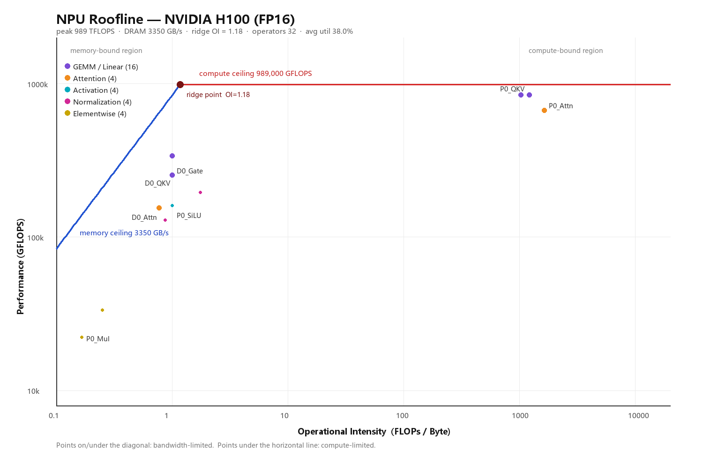

# NPU Roofline 静态分析工具

专为大模型算子设计的 NPU 性能分析工具，基于 Roofline 模型提供计算强度分析、性能上界建模、瓶颈识别和优化建议。

## ✨ 特性

- **🎯 面向大模型**: 内置 Transformer、Attention、MoE、KV Cache 等大模型核心算子模型
- **🏗️ 硬件建模**: 预设 H100、A100、Ascend 910B 等主流 NPU/GPU 规格，**支持完全自定义多级存储层级**
- **📊 多层级 Roofline**: 同时建模 Register、L1/Shared、L2、HBM、CXL、NVLink、SSD 等任意层级存储带宽上界
- **🔍 瓶颈自动识别**: 自动判断算子是计算受限、L1/L2/HBM 受限、通信受限还是延迟受限
- **📈 丰富可视化**: ASCII 终端图表、Plotly 交互图、Matplotlib 代码、Markdown 报表、Pillow PNG
- **🔌 多框架支持**: 支持 PyTorch FX、ONNX、HuggingFace Transformers 模型解析
- **💻 CLI & API**: 命令行工具与 Python API 双模式使用

## 🚀 快速开始

### 安装

```bash
# 基础安装
pip install npu-roofline-analyzer

# 含可选依赖 (PyTorch/ONNX/HF/绘图)
pip install npu-roofline-analyzer[all]
```

### 命令行使用

```bash
# 列出支持的算子
npu-roofline list-ops

# 列出预设硬件
npu-roofline list-hardware

# 分析单个 GEMM 算子
npu-roofline analyze-op gemm --hardware h100 --dtype fp16 \
    --params M=4096 N=4096 K=4096 batch=1

# 分析 FlashAttention
npu-roofline analyze-op attention --hardware h100 \
    --params batch=1 seq_len=2048 num_heads=32 head_dim=128 use_flash=true

# 分析完整 Transformer 模型 (类 LLaMA)
npu-roofline analyze-model transformer --hardware h100 \
    --output llama_result --plot llama_plot

# 分析推理阶段 (KV Cache)
npu-roofline analyze-model inference --hardware h100

# 分析 MoE 模型
npu-roofline analyze-model moe --hardware h100
```

### Python API 使用

```python
from npu_roofline_analyzer import (
    NPUHardwareSpec,
    NPURooflineAnalyzer,
    RooflineVisualizer,
    registry,
)

# 1. 选择硬件
hardware = NPUHardwareSpec.from_preset("h100")

# 2. 创建分析器
analyzer = NPURooflineAnalyzer(hardware, dtype="fp16")
visualizer = RooflineVisualizer(hardware, dtype="fp16")

# 3. 分析单个算子
gemm_op = registry.analyze("gemm", M=4096, N=4096, K=4096, batch=1, dtype="fp16")
point = analyzer.analyze_operator(gemm_op)
print(f"GEMM 性能: {point.achieved_gflops:.1f} GFLOPS, 瓶颈: {point.bottleneck}")

# 4. 分析 Attention
attn_op = registry.analyze("attention", 
    batch=1, seq_len=2048, num_heads=32, head_dim=128,
    dtype="fp16", use_flash=True
)
point = analyzer.analyze_operator(attn_op)
print(f"Attention 性能: {point.achieved_gflops:.1f} GFLOPS")

# 5. 批量分析模型并可视化
# ... 构建算子列表 ...
result = analyzer.analyze_model(ops)
print(visualizer.generate_ascii_plot(result))
print(visualizer.export_summary_table(result))

# 6. 导出绘图数据
plotly_data = visualizer.generate_plotly_data(result)
# 可直接用 plotly 绘制交互图表
```

## 📖 核心概念

### Roofline 模型

Roofline 模型将算子性能上界建模为两条线的包络：
- **计算上界**: 硬件峰值算力 (TFLOPS)
- **内存上界**: 内存带宽 × 计算强度 (FLOPs/Byte)

实际性能 = min(计算上界, 内存上界)

### 多级存储 Roofline（本工具核心特性）

当存储系统有多级（L1 → L2 → HBM → CXL → NVLink → SSD）时，每一级都有一条带宽斜线：

```
性能
  ↑
  │  ╭───────────── 峰值算力
  │  │
  │  │      ╭────── L1 带宽上界 (Ridge_L1)
  │  │      │
  │  │      │    ╭── L2 带宽上界 (Ridge_L2)
  │  │      │    │
  │  │      │    │  ╭ HBM 带宽上界 (Ridge_HBM)
  │  │      │    │  │
  │  │      │    │  │  ╭ CXL 带宽上界
  └──┴──────┴────┴──┴──┴─────→ OI
     R_L1   R_L2  R_HBM R_CXL
```

**瓶颈判定逻辑**：从最近存储层级向外遍历，第一个 `OI < Ridge_Point` 的层级即为瓶颈所在。

| 瓶颈类型 | 判断条件 | 优化方向 |
|----------|----------|----------|
| `compute` | OI > 所有 Ridge Point | 提升占用率、Tensor Core、混合精度 |
| `memory_bound_L1` | OI < Ridge_L1 | 寄存器压力、共享内存 Bank Conflict、分块粒度 |
| `memory_bound_L2` | Ridge_L1 ≤ OI < Ridge_L2 | **分块留 L2、避免 L2 Thrashing、双缓冲预取** |
| `memory_bound_HBM` | Ridge_L2 ≤ OI < Ridge_HBM | **算子融合、降精度、近存计算、压缩** |
| `memory_bound_CXL` | Ridge_HBM ≤ OI < Ridge_CXL | 热/冷数据分离、预取、Offload 策略 |
| `memory_bound_NVLink` | 通信量大、Peer 带宽受限 | 通信重叠、拓扑感知、量化通信 |
| `latency` | 远低于所有上界 | 减少同步、流水线并行、异步执行、CUDA Graph |

### 计算强度 (Operational Intensity)

```
OI = 总 FLOPs / 总内存访问字节数
```

- OI 高 → 计算受限 → 优化方向: 指令吞发、Tensor Core 利用率
- OI 低 → 内存受限 → 优化方向: 算子融合、缓存复用、数据布局、降精度

---

## 🏗️ 支持的算子

| 类别 | 算子 | 关键参数 |
|------|------|----------|
| **GEMM** | `gemm`, `matmul`, `linear` | M, N, K, batch, trans_a/b, has_bias |
| **Attention** | `attention`, `flash_attention`, `multihead_attention` | batch, seq_len, num_heads, head_dim, causal, flash, kv_cache |
| **Activation** | `gelu`, `relu`, `silu`, `swish`, `sigmoid`, `tanh` | num_elements, inplace |
| **Normalization** | `layernorm`, `rmsnorm` | batch, seq_len, hidden_dim, eps |
| **Elementwise** | `add`, `mul`, `div`, `sub`, `fma` | num_elements, num_inputs, broadcast |
| **Reduction** | `sum`, `mean`, `max`, `min` | input_shape, reduce_dims, keepdim |
| **Memory** | `transpose`, `reshape`, `view`, `copy` | input_shape, output_shape |
| **Communication** | `allreduce`, `allgather`, `reducescatter` | num_elements, world_size, bandwidth, algorithm |

---

## 🎮 预设硬件配置

| 预设 | 说明 | FP16 TFLOPS | HBM 带宽 | L2 带宽 | L1 带宽 |
|------|------|-------------|----------|---------|---------|
| `h100` | NVIDIA H100 (HBM3) | 989 | 3350 GB/s | 3.3 TB/s | 10 TB/s |
| `a100` | NVIDIA A100 (HBM2e) | 312 | 1555 GB/s | 1.5 TB/s | 6 TB/s |
| `ascend910b` | 华为昇腾 910B | 358 | 1200 GB/s | 1.2 TB/s | 4 TB/s |
| `generic_npu` | 通用 NPU 参考 | 100 | 512 GB/s | 512 GB/s | 2 TB/s |

---

## ⚙️ 多级存储自定义指南（核心新功能）

### 方式一：Python 代码完全自定义（最灵活）

```python
from npu_roofline_analyzer import NPUHardwareSpec, NPURooflineAnalyzer

# 任意层级：Register → L1 → L2 → HBM → CXL → NVLink → SSD
custom_spec = NPUHardwareSpec(
    name="my_llm_node",
    compute_units=[
        {"name": "core", "peak_tflops": {"fp16": 1000, "fp8": 2000}, "count": 1}
    ],
    memory_levels=[
        {"name": "register", "bandwidth_gb_s": 20000, "capacity_kb": 256},
        {"name": "l1",       "bandwidth_gb_s": 10000, "capacity_kb": 128},
        {"name": "l2",       "bandwidth_gb_s": 3000,  "capacity_mb": 40},
        {"name": "hbm",      "bandwidth_gb_s": 1500,  "capacity_gb": 80},
        {"name": "cxl",      "bandwidth_gb_s": 100,   "capacity_gb": 512},   # 远内存
        {"name": "nvlink",   "bandwidth_gb_s": 400,   "capacity_gb": 0},     # Peer 互联
        {"name": "ssd",      "bandwidth_gb_s": 10,    "capacity_tb": 4},     # Offload
    ],
    # 可选：自定义效率因子（按算子类别 × 瓶颈类型）
    efficiency_factors={
        "gemm": {"compute": 0.95, "memory_bound_L2": 0.90, "memory_bound_HBM": 0.85},
        "flash_attention": {"compute": 0.90, "memory_bound_L2": 0.85, "memory_bound_HBM": 0.80},
        "elementwise": {"memory_bound_L2": 0.55, "memory_bound_HBM": 0.45},
        "paged_attention": {"memory_bound_HBM": 0.70, "memory_bound_CXL": 0.55},  # 自定义算子
        "kv_cache_read": {"memory_bound_HBM": 0.65, "memory_bound_CXL": 0.50, "memory_bound_SSD": 0.30},
    }
)

analyzer = NPURooflineAnalyzer(custom_spec, dtype="fp16")
```

**`memory_levels` 关键字段：**

| 字段 | 含义 | 单位 | 用途 |
|------|------|------|------|
| `name` | 层级标识 | — | 瓶颈类型后缀、绘图标签 |
| `bandwidth_gb_s` | 可持续带宽 | GB/s | 画 Roofline 斜线、计算 Ridge Point |
| `capacity_kb/mb/gb/tb` | 容量 | KB/MB/GB/TB | 判定算子工作集落在哪级（按从小到大遍历） |
| `bytes_per_cycle` | 单周期传输字节 | B/cycle | 细粒度建模（可选） |

> **判定规则**：`_estimate_applicable_bandwidth()` 按 `capacity_bytes` 升序遍历 `memory_levels`，
> 第一个 `working_set <= capacity` 的层级即为该算子的有效带宽来源。

---

### 方式二：CLI 导出模板 → 修改 JSON → 直接用

```bash
# 1. 导出预设为 JSON 模板
npu-roofline custom-hardware --preset h100 --output my_hardware.json
```

生成的 `my_hardware.json`：
```json
{
  "name": "h100_custom",
  "compute_units": [{"name": "sm", "peak_tflops": {"fp16": 989, "fp8": 1979}, "count": 132}],
  "memory_levels": [
    {"name": "register", "bandwidth_gb_s": 20000, "capacity_kb": 256},
    {"name": "l1", "bandwidth_gb_s": 10000, "capacity_kb": 128},
    {"name": "l2", "bandwidth_gb_s": 3350, "capacity_mb": 50},
    {"name": "hbm", "bandwidth_gb_s": 3350, "capacity_gb": 80}
  ],
  "efficiency_factors": {
    "gemm": 0.9,
    "flash_attention": 0.8,
    "elementwise": 0.45
  }
}
```

```bash
# 2. 编辑 JSON：增/删/改 memory_levels、调整带宽容量、加自定义效率因子
#    例如加入 CXL/NVLink/SSD 三级

# 3. CLI 直接用
npu-roofline analyze-op gemm --hardware-file my_hardware.json --dtype fp16 --params M=4096 N=4096 K=4096
npu-roofline analyze-model transformer --hardware-file my_hardware.json --output result
```

```python
# Python 里也能加载
from npu_roofline_analyzer import NPUHardwareSpec
spec = NPUHardwareSpec.from_json("my_hardware.json")
```

---

### 实战示例：KV-Cache 分层 Offload 场景

> 热 KV 留 HBM，温 KV 落 CXL，冷 KV 存 SSD

```json
{
  "name": "llm_inference_node",
  "compute_units": [{"name": "core", "peak_tflops": {"fp16": 500}, "count": 1}],
  "memory_levels": [
    {"name": "register", "bandwidth_gb_s": 15000, "capacity_kb": 256},
    {"name": "l1", "bandwidth_gb_s": 8000, "capacity_kb": 128},
    {"name": "l2", "bandwidth_gb_s": 2000, "capacity_mb": 32},
    {"name": "hbm", "bandwidth_gb_s": 1000, "capacity_gb": 48},
    {"name": "cxl", "bandwidth_gb_s": 120, "capacity_gb": 256},
    {"name": "ssd", "bandwidth_gb_s": 8, "capacity_tb": 2}
  ],
  "efficiency_factors": {
    "gemm": 0.9,
    "flash_attention": 0.8,
    "paged_attention": 0.7,
    "kv_cache_read": 0.6
  }
}
```

跑 `analyze-model inference` 时，工具会根据 **当前 Batch/SeqLen 算出的 KV-Cache 大小** 自动判定落在 `hbm / cxl / ssd` 哪一级，直接给出对应带宽上界与瓶颈类型（`memory_bound_HBM` / `memory_bound_CXL` / `memory_bound_SSD`）。

---

## 📊 输出示例

### PNG Roofline 图（无需 matplotlib，仅依赖 Pillow）

```bash
python render_roofline_png.py      # 生成 roofline_mixed.png + demo_roofline_mixed.json
```

图中同时画了 Prefill 与 Decode 两组算子，便于对照：

| 场景 | 计算强度 | 性能 | 结论 |
|------|----------|------|------|
| Prefill (B=1, L=2048) | OI ≈ 1024–1642 | 668–846 TFLOPS | 计算受限，已接近峰值 |
| Decode (B=1, KV=2048) | OI ≈ 0.77–1.0 | 129–254 TFLOPS | 内存受限，落在 DRAM 斜线上 |



### ASCII Roofline 图表（自动显示多级 Ridge Point）

```
                                                                         
  10000 ┤                                                                 
       │                                                                 
  1000 ┤                    ═══════════════════════════════════════════
       │                    Compute Peak: 989000 GFLOPS                  
   100 ┤              ┈┈┈┈┈┈┈┈┈┈┈┈┈┈┈┈┈┈┈┈┈┈┈┈┈┈┈┈┈┈┈┈┈┈┈┈┈┈┈┈┈┈┈┈┈┈┈
       │            ┄┄┄┄┄┄┄┄┄┄┄┄┄┄┄┄┄┄┄┄┄┄┄┄┄┄┄┄┄┄┄┄┄┄┄┄┄┄┄┄┄┄┄┄┄┄┄┄
    10 ┤        ┈┈┈┈┈┈┈┈┈┈┈┈┈┈┈┈┈┈┈┈┈┈┈┈┈┈┈┈┈┈┈┈┈┈┈┈┈┈┈┈┈┈┈┈┈┈┈┈┈┈┈┈┈
       │      ┄┄┄┄┄┄┄┄┄┄┄┄┄┄┄┄┄┄┄┄┄┄┄┄┄┄┄┄┄┄┄┄┄┄┄┄┄┄┄┄┄┄┄┄┄┄┄┄┄┄┄┄┄
     1 ┤  ┈┈┈┈┈┈┈┈┈┈┈┈┈┈┈┈┈┈┈┈┈┈┈┈┈┈┈┈┈┈┈┈┈┈┈┈┈┈┈┈┈┈┈┈┈┈┈┈┈┈┈┈┈┈┈┈┈
       │┄┄┄┄┄┄┄┄┄┄┄┄┄┄┄┄┄┄┄┄┄┄┄┄┄┄┄┄┄┄┄┄┄┄┄┄┄┄┄┄┄┄┄┄┄┄┄┄┄┄┄┄┄┄┄┄┄
       └────────────────────────────────────────────────────────────
        0.01    0.1      1       10      100     1000    10000
                    Operational Intensity (FLOPs/Byte)

图例: ●=Compute  ■=L2-bound  ▲=HBM-bound  ◆=CXL-bound  ★=NVLink-bound
Ridges: L1=1.0  L2=0.3  HBM=0.1  CXL=0.01 (FLOP/Byte @ FP16)
```

### Markdown 汇总报表（含层级瓶颈）

```markdown
# Roofline 分析报告: my_llm_node (FP16)

## 硬件规格
- **峰值算力**: 500000 GFLOPS (500.0 TFLOPS)
- **存储层级**: Register(15 TB/s) → L1(8 TB/s) → L2(2 TB/s) → HBM(1 TB/s) → CXL(120 GB/s) → SSD(8 GB/s)
- **数据类型**: FP16

## 算子分析汇总

| 算子 | 类别 | 计算强度 | 实际性能 | 峰值利用率 | 瓶颈层级 |
|------|------|----------|----------|------------|----------|
| qkv_proj | gemm | 128.5 | 448000 | 89.6% | compute |
| flash_attn | attention | 3.2 | 380000 | 76.0% | memory_bound_L2 |
| paged_attn_decode | paged_attention | 0.85 | 42000 | 8.4% | memory_bound_CXL |
| kv_cache_read | kv_cache_read | 0.12 | 8000 | 1.6% | memory_bound_SSD |

## ⚠️ 优化建议
- 存在 L2-bound 算子：FlashAttention 分块可进一步提升 L2 复用
- 存在 CXL/SSD-bound 算子：KV-Cache 热数据提升至 HBM、预取策略优化
```

---

## ⚠️ 建模假设与精度说明

本工具是**静态上界估算器**，不对应某次实测，请按如下假设解读结果：

1. **FLOPs 计数规则**：GEMM 为 `2*M*N*K*batch`（乘加各记 1 次）；grouped/batched GEMM 的 `batch`
   即分组数，`group_size` 只影响调度与指针开销，**不重复计入计算量**。
2. **内存访问**：按"每个张量读写各一次"计数，未建模 cache 命中。`use_flash=True` 时才把
   Attention 中间矩阵留在片上，因此 FlashAttention 的 OI 会显著高于标准实现。
3. **内存上界**：`perf = bandwidth × OI`，`bandwidth` 由算子工作集大小启发式选择
   （能装进 L2 用 L2 带宽，否则用 DRAM）。这正是 `D0_AttnOut` 在 OI=1.0 被判为 compute-bound
   的原因——它被假设为 L2 驻留。
4. **效率因子**：按算子类别 × 瓶颈层级 × 问题规模打折（GEMM 0.85–0.95，逐元素 0.4–0.6 等），
   用于从"理论上界"逼近"可达性能"。这些系数是经验值，**换硬件/换编译器需重新标定**。
5. **通信时延**：`latency_us + comm_volume / (bandwidth_GBps × 1e9) × 1e6`，Ring/Tree 两种算法。
   不含拥塞、重传与计算通信重叠。

如果要做真实对标，建议：用 nsys/profiler 采集单算子实测 TFLOPS 与 DRAM 吞吐，替换
`analyzer.py` 中的 `_estimate_achieved_performance` 与 `_estimate_applicable_bandwidth` 经验式。

---

## 🧪 测试

```bash
python -m pytest tests/ -v      # 11 个用例
python verify_install.py        # 端到端冒烟验证
python demo.py                  # 4 组场景演示并导出 JSON/CSV/绘图数据
```

测试覆盖：硬件预设、GEMM/Attention 计算量、模型级汇总、可视化输出、CLI 导入，以及
四个回归点（grouped GEMM 重复计数、通信时延单位、通信算子耗时统计、OI=0 时绘图不崩溃）。

---

## 🔧 扩展开发

### 添加自定义算子

```python
from npu_roofline_analyzer import OperatorAnalyzer, OperatorCategory, OperatorInfo, TensorSpec, register_operator

class MyCustomOpAnalyzer(OperatorAnalyzer):
    def get_category(self):
        return OperatorCategory.CUSTOM
    
    def analyze(self, param1: int, param2: float, dtype: str = "fp16"):
        flops = param1 * param2 * 2
        memory = param1 * 4 + param2 * 4
        
        return OperatorInfo(
            name="my_custom_op",
            category=OperatorCategory.CUSTOM,
            flops=flops,
            memory_bytes=memory,
            arithmetic_intensity=flops/memory,
            input_tensors=[TensorSpec([param1], dtype)],
            output_tensors=[TensorSpec([param2], dtype)],
            params={"param1": param1, "param2": param2}
        )

register_operator("my_custom_op", MyCustomOpAnalyzer())
op_info = registry.analyze("my_custom_op", param1=1024, param2=2048)
```

### 添加自定义存储层级判定逻辑（高级）

若需更精细的层级选择（如 NUMA 亲和性、Chiplet 级共享 L2、动态分区），可继承 `NPURooflineAnalyzer` 重写：

```python
class MyAnalyzer(NPURooflineAnalyzer):
    def _estimate_applicable_bandwidth(self, op, spec):
        # 例如：按 SM 亲和性判定 L2 切片
        if op.sm_affinity is not None:
            l2_slice_bw = spec.l2_bandwidth_per_slice * op.sm_affinity.num_slices
            if op.working_set <= spec.l2_capacity_per_slice * op.sm_affinity.num_slices:
                return l2_slice_bw
        return super()._estimate_applicable_bandwidth(op, spec)
```

---

## 📁 项目结构

```
npu_roofline_analyzer/
├── __init__.py           # 主包导出
├── hardware.py           # NPU 硬件规格定义（含多级存储）
├── operators.py          # 算子注册表与基类
├── operators_gemm.py     # GEMM 族算子分析
├── operators_attention.py # Attention 族算子分析
├── operators_activation.py # 激活函数分析
├── operators_normalization.py # 归一化分析
├── operators_elementwise.py # 逐元素操作分析
├── operators_reduction.py   # 归约操作分析
├── operators_memory.py      # 内存操作分析
├── operators_communication.py # 通信算子分析
├── analyzer.py           # Roofline 核心分析引擎（多级判定）
├── models.py             # 模型解析器
├── visualizer.py         # 可视化输出（多级 Ridge 标注）
├── cli.py                # 命令行入口（custom-hardware 子命令）
└── examples/
    └── transformer_analysis.py  # Transformer 完整示例

根目录:
├── demo.py               # 4 组场景演示 (LLaMA / 推理 / MoE / 多硬件对比)
├── verify_install.py     # 冒烟验证
├── render_roofline_png.py # Pillow 渲染 Roofline PNG
└── tests/test_basic.py   # 11 个单元 + 回归测试
```

---

## 🤝 贡献指南

欢迎贡献！请遵循以下步骤：

1. Fork 项目
2. 创建特性分支 (`git checkout -b feature/amazing-feature`)
3. 提交更改 (`git commit -m 'Add amazing feature'`)
4. 推送分支 (`git push origin feature/amazing-feature`)
5. 创建 Pull Request

### 开发环境

```bash
git clone https://github.com/andyzhenghome/npu-roofline-analyzer
cd npu-roofline-analyzer
pip install -e .[dev]
pytest tests/
```

---

## 📄 许可证

MIT License - 详见 [LICENSE](LICENSE)

---

## 🙏 致谢

- Roofline 模型原论文: Williams et al., "Roofline: An Insightful Visual Performance Model for Multicore Architectures"
- NVIDIA/AMD/华为等厂商公开的硬件规格文档
- 开源社区的各类性能分析工具